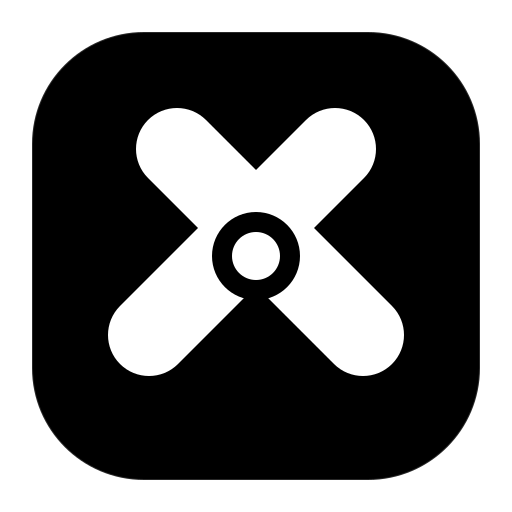

<div align="center">
  <p>
    <h1>
      
      <br />
      SlickShot
    </h1>
    <h4>Powerful yet simple to use screenshot software.</h4>
  </p>
  <p>
    <a href="https://github.com/khentmoba/slickshot/blob/master/LICENSE">
      
    </a>
  </p>
  <p>
    <em>SlickShot is an independent, standalone fork of <a href="https://github.com/flameshot-org/flameshot">Flameshot</a>.</em>
  </p>
</div>


## Index

- [Features](#features)
- [Usage](#usage)
  - [Usage on Windows](#usage-on-windows)
  - [Usage on Hyprland / Sway / wlroots](#usage-on-hyprland--sway--wlroots)
  - [Usage on minimal X11 window managers](#usage-on-minimal-x11-window-managers)
  - [CLI configuration](#cli-configuration)
  - [Config file](#config-file)
- [Keyboard Shortcuts](#keyboard-shortcuts)
  - [Local](#local)
  - [Global](#global)
    - [On KDE Plasma desktop](#on-kde-plasma-desktop)
    - [On Gnome (Ubuntu, Fedora and more)](#on-gnome-ubuntu-fedora-and-more)
    - [On XFCE 4](#on-xfce-4)
    - [On Fluxbox](#on-fluxbox)
- [Considerations](#considerations)
- [Installation](#installation)
  - [Prebuilt Packages](#prebuilt-packages)
  - [Packages from Repository](#packages-from-repository)
  - [MacOS](#macos)
  - [Windows](#windows)
- [Compilation](#compilation)
  - [Dependencies](#dependencies)
    - [Compile-time](#compile-time)
    - [Run-time](#run-time)
    - [Optional](#optional)
    - [Debian](#debian)
    - [Fedora](#fedora)
    - [Arch](#arch)
  - [Build](#build)
  - [Install](#install)
- [License](#license)
- [Privacy Policy](#privacy-policy)
- [Code Signing Policy](#code-signing-policy)
- [Contribute](#contribute)
- [Acknowledgment](#acknowledgment)

## Features

- Customizable appearance.
- Easy to use.
- In-app screenshot editing.
- DBus interface.
- Upload to Imgur.

## Usage

In the commands below, `flameshot` means the SlickShot executable. The binary is
still named `flameshot.exe` on Windows (and `flameshot` elsewhere) by design,
for compatibility with inherited shortcuts and scripts; the product itself is
SlickShot.

Executing the command `flameshot` without parameters will launch a running
instance of the program in the background without taking actions.
If your desktop environment provides tray area, a tray icon will also
appear in the tray for users to perform configuration and management.

Example commands:

- Capture with GUI:

    ```shell
    flameshot gui
    ```

- Capture with GUI with custom save path:

    ```shell
    flameshot gui -p ~/myStuff/captures
    ```

- Capture with GUI after 2 seconds delay (can be useful to take screenshots of mouse hover tooltips, etc.):

    ```shell
    flameshot gui -d 2000
    ```

- Fullscreen capture with custom save path (no GUI) and delayed:

    ```shell
    flameshot full -p ~/myStuff/captures -d 5000
    ```

- Fullscreen capture with custom save path copying to clipboard:

    ```shell
    flameshot full -c -p ~/myStuff/captures
    ```

- Capture the screen containing the mouse and print the image (bytes) in PNG format:

    ```shell
    flameshot screen -r
    ```

- Capture the screen number 1 and copy it to the clipboard:

    ```shell
    flameshot screen -n 1 -c
    ```

In case of doubt choose the first or the second command as shortcut in your favorite desktop environment.

A systray icon will be in your system's panel while SlickShot is running.
Do a right click on the tray icon and you'll see some menu items to open the configuration window and the information window.
Check out the About window to see all available shortcuts in the graphical capture mode.

### Usage on Windows

On Windows, `flameshot.exe` will behave as expected for all supported command-line arguments, 
but it will not output any text to the console. This is problematic if, for example, you are 
running `flameshot.exe -h`.

If you require console output, run `flameshot-cli.exe` instead. `flameshot-cli.exe` is a minimal wrapper around `flameshot.exe` that ensures all stdout is captured and output to the console.

### Usage on Hyprland / Sway / wlroots

Please [refer to this document](docs/UsageHyprlandSwayWlroots.md) for detailed instructions on how to set up SlickShot on Hyprland, Sway, and wlroots-based Wayland compositors.

### Usage on minimal X11 window managers

On minimal X11 window managers (i3, dwm, xmonad, bspwm, ...), capturing may fail because no portal backend implements the Screenshot interface (errors such as *"Could not locate the org.freedesktop.portal.Desktop service"* or *"Screenshot portal timed out"*). Please [refer to this document](docs/UsageX11MinimalWM.md) for the fix (enabling the legacy X11 capture).

### CLI configuration

You can use the graphical menu to configure SlickShot, but alternatively you can use your terminal or scripts to do so.

- Open the configuration menu:

    ```shell
    flameshot config
    ```

- Show the initial help message in the capture mode:

    ```shell
    flameshot config --showhelp true
    ```

- For more information about the available options use the help flag:

    ```shell
    flameshot config -h
    ```

### Config file

You can also edit some of the settings (like overriding the default colors) in
the configuration file. Where it lives depends on the build:

- **Release installer builds (Windows)** use portable config disabled
  (`USE_PORTABLE_CONFIG=false`). Settings are stored through QSettings in user
  scope, at
  `C:\Users\{YOURNAME}\AppData\Roaming\flameshot\flameshot.ini`
  (`%APPDATA%\flameshot\flameshot.ini`). The `flameshot` directory name is
  inherited from Flameshot; the file belongs to SlickShot. Upgrades keep this
  file, so your settings survive a reinstall.
- **Portable builds** use portable config enabled (`USE_PORTABLE_CONFIG=true`).
  The settings file is `flameshot.ini` in the same folder as `flameshot.exe`.
  Source builds on Windows default to portable config; the release installer
  explicitly turns it off.
- **Linux builds** use `~/.config/flameshot/flameshot.ini`.

When copying over the config file between platforms or between an installer
build and a portable build, make sure to correct the `savePath` variable so that
screenshots are saved in the right directory.

## Keyboard shortcuts

### Local

These shortcuts are available in GUI mode:

|  Keys                                                                     |  Description                                                   |
|---                                                                        |---                                                             |
| <kbd>P</kbd>                                          | Set the Pencil as paint tool |
| <kbd>D</kbd>                                          | Set the Line as paint tool |
| <kbd>A</kbd>                                          | Set the Arrow as paint tool |
| <kbd>S</kbd>                                          | Set Selection as paint tool |
| <kbd>R</kbd>                                          | Set the Rectangle as paint tool |
| <kbd>C</kbd>                                          | Set the Circle as paint tool |
| <kbd>M</kbd>                                          | Set the Marker as paint tool |
| <kbd>T</kbd>                                          | Add text to your capture |
| <kbd>B</kbd>                                          | Set Pixelate as the paint tool |
| <kbd>←</kbd>, <kbd>↓</kbd>, <kbd>↑</kbd>, <kbd>→</kbd>                    | Move selection 1px                                             |
| <kbd>Shift</kbd> + <kbd>←</kbd>, <kbd>↓</kbd>, <kbd>↑</kbd>, <kbd>→</kbd> | Resize selection 1px                                           |
| <kbd>Ctrl</kbd> + <kbd>Shift</kbd> + <kbd>←</kbd>, <kbd>↓</kbd>, <kbd>↑</kbd>, <kbd>→</kbd> | Symmetrically resize selection 2px                                           |
| <kbd>Esc</kbd>                                                            | Quit capture                                                   |
| <kbd>Ctrl</kbd> + <kbd>M</kbd>                                            | Move the selection area                                              |
| <kbd>Ctrl</kbd> + <kbd>C</kbd>                                            | Copy to clipboard                                              |
| <kbd>Ctrl</kbd> + <kbd>S</kbd>                                            | Save selection as a file                                       |
| <kbd>Ctrl</kbd> + <kbd>Z</kbd>                                            | Undo the last modification                                     |
| <kbd>Ctrl</kbd> + <kbd>Shift</kbd> + <kbd>Z</kbd>                                            | Redo the next modification                    |
| <kbd>Ctrl</kbd> + <kbd>Q</kbd>                                            | Leave the capture screen                                         |
| <kbd>Ctrl</kbd> + <kbd>O</kbd>                                            | Choose an app to open the capture                                |
| <kbd>Ctrl</kbd> + <kbd>Return</kbd>                                            | Commit text in text area|
| <kbd>Ctrl</kbd> + <kbd>Backspace</kbd>                                    | Cancel current selection                                       | 
| <kbd>Return</kbd>                                             | Upload the selection to Imgur                                      |
| <kbd>Spacebar</kbd>                                                       | Toggle visibility of sidebar with options of the selected tool, color picker for the drawing color and history menu |
| <kbd>G</kbd>                                                       | Starts the color picker |
| Right Click                                                               | Show the color wheel                                              |
| Mouse Wheel                                                               | Change the tool's thickness                                    |
| <kbd>Print screen</kbd>                                          | Capture Screen |
| <kbd>Shift</kbd> + <kbd>Print</kbd>                                            | Screenshot History                                     |
| <kbd>Ctrl</kbd> + drawing *line*, *arrow* or *marker*      | Drawing only horizontally, vertically or diagonally |
| <kbd>Ctrl</kbd> + drawing *rectangle* or *circle*      | Keeping aspect ratio |

<kbd>Shift</kbd> + drag a handler of the selection area: mirror redimension in the opposite handler.

### Global

- Windows: Seamlessly replaces Windows Snipping Tool out of the box!
  - <kbd>Win</kbd> + <kbd>Shift</kbd> + <kbd>S</kbd>: Direct capture overlay (intercepted via low-level hook)
  - <kbd>Prt Sc</kbd>: Direct capture overlay (Windows 11 Snipping Tool hijacking disabled)
  - <kbd>Shift</kbd> + <kbd>Prt Sc</kbd>: Capture history / full capture
  - Windows screen clipping protocol (`ms-screenclip:`), Action Center "Screen Snip", and `SnippingTool.exe` redirection
- macOS: <kbd>cmd</kbd> + <kbd>Shift</kbd> + <kbd>X</kbd> (can be changed in the settings)
- Linux: SlickShot doesn't yet support <kbd>Prt Sc</kbd> out of the box, but you can set this up with a bit of configuration:

#### On KDE Plasma desktop

To make configuration easier, there's a [file](docs/shortcuts-config/flameshot-shortcuts-kde.kksrc) in the repository that more or less automates this process. This file will assign the following hotkeys by default:

|  Keys                                                  |  Description                                                                       |
|---                                                     |---                                                                                 |
| <kbd>Prt Sc</kbd>                                      | Start the SlickShot screenshot tool and take a screenshot                          |
| <kbd>Ctrl</kbd> + <kbd>Prt Sc</kbd>                    | Wait for 3 seconds, then start the SlickShot screenshot tool and take a screenshot |
| <kbd>Shift</kbd> + <kbd>Prt Sc</kbd>                   | Take a full-screen (all monitors) screenshot and save it                           |
| <kbd>Ctrl</kbd> + <kbd>Shift</kbd> + <kbd>Prt Sc</kbd> | Take a full-screen (all monitors) screenshot and copy it to the clipboard          |

If you don't like the defaults, they can be changed later.

Steps for using the configuration:

1. The configuration file makes SlickShot automatically save screenshots to `~/Pictures/Screenshots` without opening the save dialog. Make sure that folder exists by running:

    ```shell
    mkdir -p ~/Pictures/Screenshots
    ```

    (If you don't like the default location, you can skip this step and configure your preferred directory later.)
2. Download the configuration file:

    ```shell
    cd ~/Desktop
    wget https://raw.githubusercontent.com/khentmoba/slickshot/master/docs/shortcuts-config/flameshot-shortcuts-kde.kksrc
    ```
3. Make sure you have the `khotkeys` installed using your package manager to enable custom shortcuts in KDE Plasma.
4. Go to _System Settings_ → _Shortcuts_ → _Custom Shortcuts_.
5. If an entry exists for Spectacle (the default KDE screenshot utility), you'll need to disable it because its shortcuts might conflict with SlickShot's. Do this by unchecking the _Spectacle_ entry.
6. Click _Edit_ → _Import..._, navigate to the configuration file and open it.
7. Now the SlickShot entry should appear in the list. Click _Apply_ to apply the changes.
8. If you want to change the default hotkeys, you can expand the entry, select the appropriate action and modify it as you wish; the process is pretty self-explanatory.

#### On Gnome (Ubuntu, Fedora and more)

To use SlickShot instead of the default screenshot application in Gnome we need to remove the binding on <kbd>Prt Sc</kbd> key, and then create a new binding for `flameshot gui` (the SlickShot executable) ([adapted](https://askubuntu.com/posts/1039949/revisions) from [Pavel's answer on AskUbuntu](https://askubuntu.com/revisions/1036473/1)).

1. Remove the binding on <kbd>Prt Sc</kbd>:
  
   Go to _Settings_ > _Keyboard_ > _View and Customise Shortcuts_ > _Screenshots_ > _Take a screenshot interactively_ and press `backspace`

2. Add custom binding on <kbd>Prt Sc</kbd>:
  
   Go to _Settings_ > _Keyboard_ > _View and Customise Shortcuts_ > _Custom shortcuts_ and press the '+' button at the bottom.

3. Name the command as you like it, e.g. `SlickShot`. In the command, insert the path to the SlickShot executable followed by `gui` (for example `/usr/bin/flameshot gui` if installed there).

4. Then click "_Set Shortcut.._" and press <kbd>Prt Sc</kbd>. This will show as "_print_".

Now every time you press <kbd>Prt Sc</kbd>, it will start the SlickShot GUI instead of the default application.

#### On XFCE 4

1. Go to `Keyboard` settings
2. Switch to the tab `Application Shortcuts`
3. Find the entry

    ```text
    Command                        Shortcut
    xfce4-screenshooter -fd 1      Print
    ```
4. Replace `xfce4-screenshooter -fd 1` with `flameshot gui`

Now every time you press <kbd>Prt Sc</kbd> it will start SlickShot GUI instead of the default application.

#### On Fluxbox

1. Edit your `~/.fluxbox/keys` file
2. Add a new entry. `Print` is the key name, `flameshot gui` is the shell command; for more options see [the fluxbox wiki](https://sillyslux.github.io/fluxbox-wiki/en/wiki/Keyboard-Shortcuts/).

    ```text
    Print :Exec flameshot gui
    ```
3. Refresh Fluxbox configuration with **Reconfigure** option from the menu.

## Considerations

- Experimental Gnome Wayland and Plasma Wayland support.

- If you are using Gnome you need to install the [AppIndicator and KStatusNotifierItem Support](https://extensions.gnome.org/extension/615/appindicator-support/) extension in order to see the system tray icon.

- Press <kbd>Enter</kbd> or <kbd>Ctrl</kbd> + <kbd>C</kbd> when you are in a capture mode and you don't have an active selection and the whole desktop will be copied to your clipboard. Pressing <kbd>Ctrl</kbd> + <kbd>S</kbd> will save your capture to a file. Check the [Shortcuts](#keyboard-shortcuts) for more information.

- SlickShot works best with a desktop environment that includes D-Bus. The upstream [Flameshot troubleshooting article](https://wiki.archlinux.org/title/Flameshot#Troubleshooting) has general tips that also apply to SlickShot's inherited Linux support in minimal window managers (dwm, i3, xmonad, etc).

- In order to speed up the first launch of SlickShot (D-Bus init of the app can be slow), consider starting the application automatically on boot.
    - Quick tip: If you don't have SlickShot to autostart at boot and you want to set a keyboard shortcut, use the following as the command for the keybinding:
    ```sh
    ( flameshot &; ) && ( sleep 0.5s && flameshot gui )
    ```

## Installation

SlickShot is Windows-first. Ready-made Windows builds are published on
[the SlickShot releases page](https://github.com/khentmoba/slickshot/releases).
On Linux and macOS, build from source (see [Compilation](#compilation)).

### Prebuilt packages

Windows releases provide a per-user installer (`.exe`) and a portable ZIP, each
with a `.sha256sum` checksum file, on
[the SlickShot releases page](https://github.com/khentmoba/slickshot/releases).
No signing is applied to these builds; see [Code Signing Policy](#code-signing-policy).

### Packages from Repository

SlickShot is a separate fork of Flameshot and is not packaged by Linux
distributions or third-party repositories. Distribution packages named
`flameshot` install Flameshot, not SlickShot. Use a SlickShot release (Windows)
or build from source.

### macOS

There is no official macOS package for SlickShot. Build it from source using
the CMake commands in [Compilation](#compilation); the `flameshot` command in
those instructions runs the SlickShot binary.

### Windows

Download the installer (`SlickShot-*-win64-setup.exe`) or the portable ZIP from
[the SlickShot releases page](https://github.com/khentmoba/slickshot/releases).
The installer is per-user and does not require administrator rights. There is
no SlickShot Scoop package; `scoop install flameshot` installs Flameshot, not
SlickShot.

When downloaded on Windows (via installer or portable package), SlickShot automatically replaces the default Windows Snipping Tool:
- Intercepts **<kbd>Win</kbd> + <kbd>Shift</kbd> + <kbd>S</kbd>** and **<kbd>Prt Sc</kbd>** via system-level low-level hooks for instant capture.
- Registers SlickShot capabilities and protocol handlers for screen clipping.
- Redirects `SnippingTool.exe` so command or Run dialog launches open SlickShot.
- Automatically launches in the background on startup for instant activation.

Can be toggled anytime in SlickShot Settings under **Shortcuts** -> **Replace Windows Snipping Tool**.

### Tray icon

**Note** that for the SlickShot icon to appear in your tray area, you should have systray software installed. This is especially true for users who use minimal [window managers](https://wiki.archlinux.org/title/window_manager) such as [dwm](https://dwm.suckless.org/). In some [desktop environments](https://wiki.archlinux.org/title/Desktop_environment) (for example GNOME), the systray might be missing, so you may need an application or plugin such as the [GNOME Shell extension](https://extensions.gnome.org/extension/1503/tray-icons/) to add it. Some systray implementations do not show every application's icon; try another indicator extension if that happens.


Alternatively, in case you don't want to have a systray, you can always call SlickShot from the terminal. See [Usage section](#usage).

## Compilation

To build the application in your system, you'll need to install the dependencies needed for it and package names might be different for each distribution, see [Dependencies](#dependencies) below for more information. You can also install most of the Qt dependencies via [their installer](https://www.qt.io/download-qt-installer). If you were developing Qt apps before, you probably already have them.

This project uses [CMake](https://cmake.org/) build system, so you need to install it in order to build the project (on most Linux distributions it is available in the standard repositories as a package called `cmake`). If your distribution provides too old version of CMake (e.g. Ubuntu or Debian) you can [download it on the official website](https://cmake.org/download/).

Also you can open and build/debug the project in a C++ IDE. For example, in Qt Creator you should be able to simply open `CMakeLists.txt` via `Open File or Project` in the menu after installing CMake into your system. [More information about CMake projects in Qt Creator](https://doc.qt.io/qtcreator/creator-project-cmake.html).

### Dependencies

#### Compile-time

- Qt >= 6.2.4 (available by default on Ubuntu Jammy)
  + Development tools
- GCC >= 11
- CMake >= 3.22

#### Run-time

- Qt
  + SVG

#### Optional

- Git
- OpenSSL
- CA Certificates
- Qt Image Formats - for additional export image formats (e.g. tiff, webp, and more)

#### Debian

```shell
# Compile-time
apt install g++ cmake build-essential qt6-base-dev qt6-tools-dev-tools qt6-svg-dev qt6-tools-dev

# Run-time
apt install libkf6guiaddons-dev libqt6dbus6 libqt6network6 libqt6core6 libqt6widgets6 libqt6gui6 libqt6svg6 qt6-qpa-plugins

# Optional
apt install git openssl ca-certificates qt6-image-formats-plugins
```

#### Fedora

```shell
# Compile-time
dnf install gcc-c++ cmake qt6-qtbase-devel qt6-qtsvg-devel qt6-qttools qt6-linguist qt6-qttools-devel kf6-kguiaddons-devel

# Run-time
dnf install qt6-qtbase qt6-qtsvg kf6-kguiaddons

# Optional
dnf install git openssl ca-certificates qt6-qtimageformats
```

#### Arch

```shell
# Compile-time
pacman -S cmake base-devel git qt6-base qt6-tools kguiaddons

# Run-time
pacman -S qt6-svg

# Optional
pacman -S openssl ca-certificates qt6-imageformats
```

#### Nix

Development Shell:
```shell
# Without flakes:
nix-shell

# With flakes:
nix develop
```

```shell
# Build flameshot
nix build

# Build and run flameshot
nix run
```

#### macOS

First of all you need to install [brew](https://brew.sh) and then install the dependencies
```shell
brew install qt6
brew install cmake
```

### Build

After installing all the dependencies, SlickShot can be built.

#### Installation/build dir
For the translations to be loaded correctly, the build process needs to be aware of where you want
to install SlickShot.

```shell
# Directory where build files will be placed, may be relative
export BUILD_DIR=build

# Directory prefix where SlickShot will be installed. If you are just building and don't want to
# install, comment this environment variable.
# This excludes the bin/flameshot part of the install,
# e.g. in /opt/flameshot/bin/flameshot, the CMAKE_INSTALL_PREFIX is /opt/flameshot
# This must be an absolute path. Requires CMAKE 3.29.
export CMAKE_INSTALL_PREFIX=/opt/flameshot

# Linux
cmake -S . -B "$BUILD_DIR" \
    && cmake --build "$BUILD_DIR"

#MacOS
cmake -S . -B "$BUILD_DIR" \
    -DQt6_DIR="$(brew --prefix qt6)/lib/cmake/Qt6" \
    && cmake --build "$BUILD_DIR"
```

When the `cmake --build` command has completed you can launch SlickShot from the `project_folder/build/src` folder.

### Install

Note that if you install from source, there _is no_ uninstaller, so consider installing to a custom directory.

#### To install into a custom directory
Make sure you are using cmake `>= 3.29` and build SlickShot with `$CMAKE_INSTALL_PREFIX` set to the
installation directory. If this is not done, the translations won't be found when using a custom directory.
Then, run the following:

```bash
# !Build with CMAKE_INSTALL_PREFIX and use cmake >= 3.29! Using an older cmake will cause
# installation into the default /usr/local dir.

# You may need to run this with privileges
cmake --install "$BUILD_DIR"
```

#### To install to the default install directory
```bash
# You may need to run this with privileges
cmake --install "$BUILD_DIR"
```

### FAQ

SlickShot does not have a separate FAQ site. Check the
[issue tracker](https://github.com/khentmoba/slickshot/issues) for known issues
and answers, and open a new issue if your question is not covered.

## License

- The main code is licensed under [GPLv3+](LICENSE)
- The SlickShot logo and branding assets are licensed under [GPLv3+](LICENSE)
- The button icons are licensed under Apache License 2.0. See: https://github.com/google/material-design-icons
- The code at capture/capturewidget.cpp is based on https://github.com/ckaiser/Lightscreen/blob/master/dialogs/areadialog.cpp (GPLv2)
- The code at capture/capturewidget.h is based on https://github.com/ckaiser/Lightscreen/blob/master/dialogs/areadialog.h (GPLv2)
- I copied a few lines of code from KSnapshot regiongrabber.cpp revision `796531` (LGPL)
- Qt-Color-Widgets taken and modified from https://github.com/mbasaglia/Qt-Color-Widgets (see their license and exceptions in the project) (LGPL/GPL)

Info: If I take code from your project and that implies a relicense to GPLv3+, you can reuse my changes with the original previous license of your project applied.

## Privacy Policy

This program will not transfer any information to other networked systems unless specifically requested by the user or the person installing or operating it.

## Code Signing Policy

Current SlickShot Windows builds are **unsigned**: no code-signing step exists
in this repository's automation, and signing is not a requirement for releases.
Windows SmartScreen may therefore show a warning when you run the installer or
the executable for the first time. You can check the published SHA-256 checksum
(`*.sha256sum`) to confirm the file matches the release asset.

This may change if signing is added later; until then, do not expect a signed
binary from these release assets.

## Contribute

If you want to contribute check the [CONTRIBUTING.md](docs/CONTRIBUTING.md)

## Acknowledgment

Thanks to those who have shown interest in the early development process:
- [lupoDharkael](https://github.com/lupoDharkael)
- [Cosmo](https://github.com/philpem)
- [XerTheSquirrel](https://github.com/XerTheSquirrel)
- [The members of Sugus GNU/Linux](https://github.com/SUGUS-GNULinux)
- ismatori

The inherited project also acknowledges its past sponsors (Namecheap, JetBrains,
SignPath and addy.io). SlickShot's Windows builds are unsigned; see
[Code Signing Policy](#code-signing-policy).
